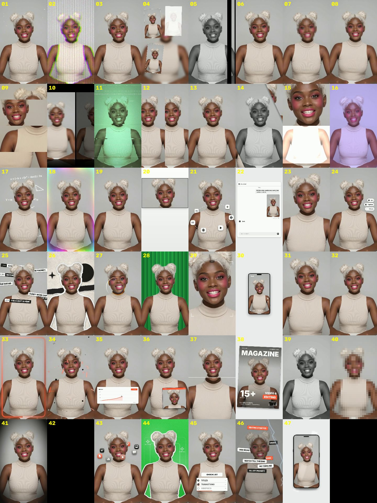

# Video Effects Pack

[Русская версия](README.ru.md)

47 ready-made video effects for short vertical clips (TikTok, Reels, Shorts), packaged as an **Agent Skill**: glitch and shake presets, zooms, intros and transitions, a magazine cover, an AI-chat card, phone mock-ups, glowing frames, charts, checklists, headline storms, orbiting icons and more.

You can use it two ways:

- **Through an AI assistant, no terminal.** Install the skill once, attach a video in the chat and say what you want ("add the magazine cover effect at 1 s, title DAILY"). The assistant runs everything and gives you the finished file.
- **Through the command line**, if you prefer.

Everything is rendered locally with Python and ffmpeg. No cloud service, no API key.



*Frames of all 47 effects, numbered as in `--list` (a sample clip with an AI-generated person).*

## Works with

| Platform | How the skill is installed |
|---|---|
| Claude (claude.ai, Claude Desktop) | upload `video-effects-pack.zip` in Settings |
| Claude Code | copy the folder to `.claude/skills/` |
| OpenAI Codex (app, CLI, IDE) | copy the folder to `.agents/skills/` or install from the GitHub URL with `$skill-installer` |
| Google Antigravity | copy the folder to `.agents/skills/` in your workspace |

The skill is a single folder, `skills/video-effects-pack/`, in the open Agent Skills format (a `SKILL.md` with instructions plus scripts and assets), so the same folder works everywhere. The instructions for the assistant are in English; the assistant answers in your language.

> **Honesty note.** The scripts and all 47 effects are tested on Linux with Python 3.13, ffmpeg and OpenCV 5.0 (plus a spot check with OpenCV 4.14). The installation steps for each platform follow those products' public documentation at the time of writing; folder locations and menus can change, so check the current docs if something is not found.

## Requirements

- Python 3.9 or newer
- `numpy`, `opencv-python` (or `opencv-python-headless`), `pillow`
- `ffmpeg` and `ffprobe` on your PATH
- A vertical 9:16 video (1080x1920 recommended). Other sizes run but were not tested.

Where the assistant works on **your own computer** (Claude Code, Codex, Antigravity, Claude Desktop with local tools), these must be installed there. In **claude.ai**, the skill runs in Anthropic's sandbox, where the available packages and network access depend on your plan and settings. If the sandbox cannot provide ffmpeg or install packages, the assistant will tell you; use the command line on your own computer instead.

**Before you start (only what is missing):** if `python --version` (or `python3 --version`) prints 3.9 or newer, and `ffmpeg -version` works, you already have the hard part; the assistant installs the Python packages itself. If something is missing:

```
# Windows (PowerShell)   winget install Python.Python.3.12
#                        winget install Gyan.FFmpeg      (then open a new terminal)
# macOS (Homebrew)       brew install python ffmpeg
# Linux (Debian/Ubuntu)  sudo apt install python3 python3-pip ffmpeg
```

Quick install of the Python packages:

```
pip install -r requirements.txt
```

Check that everything is in place:

```
python skills/video-effects-pack/scripts/check_env.py
```

It prints `OK` / `MISSING` for each item and ends with `READY` or `NOT READY`.

## Install the skill (no terminal needed)

### Claude (claude.ai and Claude Desktop)

1. Download `video-effects-pack.zip` from the Releases page of this repository (or build it: `python tools/make_zip.py`, the file appears in `dist/`).
2. Open **Settings → Capabilities → Skills** and upload the ZIP. Skills need a plan that includes them and **code execution** enabled.
3. In a chat, attach your video and ask, for example: *"Add a glitch effect to this video from 2 s to 5 s."*

### Claude Code

Put the folder in your project or home directory:

```
<project>/.claude/skills/video-effects-pack/     (this project only)
~/.claude/skills/video-effects-pack/             (all projects)
```

### OpenAI Codex

Either copy the folder to one of these places:

```
<project>/.agents/skills/video-effects-pack/     (this repository only)
$HOME/.agents/skills/video-effects-pack/         (all projects)
```

or, inside Codex, ask it to run `$skill-installer` and give it the GitHub URL of the folder:
`https://github.com/neurolena1/video-effects-pack/tree/main/skills/video-effects-pack`.
Restart Codex if the skill does not appear. Call it by writing `$video-effects-pack` or just describe the task.

### Google Antigravity

Copy the folder to your workspace:

```
<workspace>/.agents/skills/video-effects-pack/   (this workspace)
~/.gemini/config/skills/video-effects-pack/      (global)
```

Older Antigravity versions used `.agent/skills/` and `~/.gemini/antigravity/skills/`. Start a new session after copying, then ask for an effect in the chat or type `/video-effects-pack`.

## Use it in the chat

Attach the clip and say what you want, in any language:

- "Make the video glitchy from 2 to 5 seconds."
- "Turn the clip into a magazine cover titled DAILY."
- "Show me which effects you have."
- "Same as before, but a bit slower and with the text 'NEW SEASON'."

The assistant checks the environment, makes a quick preview, renders the full clip, saves it next to your original (the original is never modified) and gives it to you.

## Just use a prompt (no installation of the skill)

Any coding agent that can run commands on your computer (Codex, Claude Code, Antigravity and similar) can use the pack straight from the repository, without installing it as a skill. Put your video in the project folder, open the agent in that folder and paste a prompt. Replace the file name and the effect with your own.

**One effect:**

> Download https://github.com/neurolena1/video-effects-pack into a subfolder. Read `skills/video-effects-pack/SKILL.md` and follow it. Check the environment; if something is missing, tell me what and propose how to install it, and wait for my OK. Then take `my-video.mp4`, apply the "vglitch" effect from 2 s to 5 s, show me a short preview first, then render the full video and save it next to the original.

**An effect with your own texts:**

> Use `video-effects-pack/skills/video-effects-pack/SKILL.md`. Turn `my-video.mp4` into a magazine cover (effect 38) starting at 1 s, masthead "DAILY", cover lines "NEW SEASON" and "IS HERE", big number "10", label "TIPS". Preview first, then render and save the result next to the original.

**Several effects in one video:**

> Use `video-effects-pack/skills/video-effects-pack/SKILL.md`. In `my-video.mp4`: a hard zoom at 0.5 s, a glitch from 2 s to 4 s, and a glowing frame at 4 s. Stack them in one render, preview first, then render and save next to the original. (Or use a ready-made look: `--preset hook`.)

**Let the agent choose:**

> Use `video-effects-pack/skills/video-effects-pack/SKILL.md`. Look at `references/effects.md` and suggest 3 effects that would suit a fast, energetic intro for `my-video.mp4`. After I pick one, preview it and render it.

Notes: the agent may ask your permission to download the repository, install Python packages or run ffmpeg; approve what you are comfortable with. Python and ffmpeg must exist on your computer (see "Before you start").

## Use it from the command line

```
python skills/video-effects-pack/scripts/fx.py INPUT.mp4 OUTPUT.mp4 -e EFFECT [options]
```

```
# list the effects (number, id, default length, what it does)
python skills/video-effects-pack/scripts/fx.py --list

# glitch from 2 s to 5 s
python skills/video-effects-pack/scripts/fx.py in.mp4 out.mp4 -e vglitch --start 2 --end 5

# an intro effect at 1 s, stretched to 3 s
python skills/video-effects-pack/scripts/fx.py in.mp4 out.mp4 -e quickzoom --start 1 --duration 3

# a magazine cover with your own texts
python skills/video-effects-pack/scripts/fx.py in.mp4 out.mp4 -e magazine --start 1 --duration 3 \
  --text "DAILY" --items "NEW SEASON|IS HERE|10|TIPS|Inside: workflow|Gear guide|ISSUE 5|MARCH 2026"

# a quick 3-second preview
python skills/video-effects-pack/scripts/fx.py in.mp4 preview.mp4 -e 38 --preview 3
```

| Option | Meaning |
|---|---|
| `-e, --effect` | number, id, Russian name, or `all` |
| `--start`, `--end` | when the effect begins; when a continuous effect stops |
| `--duration` | length of an intro effect (range shown by `--list`) |
| `--preview N` | render only the first N seconds |
| `--repeat P` | demo: an intro effect repeats with a pause of P seconds |
| `--text`, `--items`, `--opt key=value` | texts of the scene effects (see `skills/video-effects-pack/SKILL.md`) |
| `--style` | colours of the scene effects: `minimal` (default), a file in `scripts/styles/`, or your own `.json` |
| `--lang en\|ru` | language of the default texts of some scene effects |
| `--face x,y,w,h` | mosaic only: face box as fractions of the frame |
| `--plan FILE.json`, `--preset NAME` | several effects in one render (see below); `--list-presets` shows the presets |
| `--seed`, `--crf` | random pattern; x264 quality (lower is better, default 17) |

Intro effects play once with a fixed length; continuous effects run from `--start` to `--end`. The full table of effects, lengths and allowed `--duration` ranges is in [`skills/video-effects-pack/references/effects.md`](skills/video-effects-pack/references/effects.md).

## Several effects in one render, and presets

Effects can be stacked in a single pass (the video is encoded once). Use a ready-made preset:

```
python skills/video-effects-pack/scripts/fx.py --list-presets
python skills/video-effects-pack/scripts/fx.py in.mp4 out.mp4 --preset hook
python skills/video-effects-pack/scripts/fx.py in.mp4 out.mp4 --preset cover-story --text "DAILY" --items "NEW|SEASON|10|TIPS"
```

Presets: `hook` (hard push-in with a short glitch burst), `glow-up` (sparkles and a glowing frame), `cover-story` (black-and-white flash, then a magazine cover), `ai-chat` (the clip lands in an AI chat, then a checklist), `party` (colour swing, pulse and sparkles). Their timings are fixed from the start of the clip and suit videos of about 5 s or longer.

Or write your own plan in a JSON file and pass `--plan plan.json`:

```json
{"effects": [
  {"effect": "quickzoom", "start": 0.5, "duration": 1.5},
  {"effect": "vglitch", "start": 2, "end": 4},
  {"effect": "magazine", "start": 4, "duration": 2.2, "text": "DAILY",
   "items": ["NEW", "SEASON", "10", "TIPS"], "opt": {"barcode": "off"}}
]}
```

Effects are applied in list order, each one on the output of the previous: put zooms, shake and colour effects first, overlays after them. Details and rules: [`skills/video-effects-pack/SKILL.md`](skills/video-effects-pack/SKILL.md). Preset files live in `skills/video-effects-pack/scripts/presets/`; copy one to make your own.

## Your own colours

Scene effects use a neutral minimalist palette. Copy `skills/video-effects-pack/scripts/styles/example-brand.json`, change the HEX colours and pass `--style your-file`.

## Saving tokens

Rendering runs locally in Python and ffmpeg and costs no tokens. Tokens are spent only on what the assistant reads and writes. As a rough estimate from file sizes (not a measurement), loading `SKILL.md` costs a few thousand tokens when the skill is used, and `references/effects.md` about as much if the assistant has to browse the effects. To keep it low:

- Name the effects, times and texts in your request. Then the assistant does not read the effect list or suggest options.
- Use a preset or a plan file for several effects instead of describing each step.
- Skip the preview when you are sure about the timing, and say "do not look at the frames": viewing images is the most expensive step.
- Reuse the same prompt for the next clip instead of starting a new explanation.

## Limitations

- Designed for vertical 9:16 clips; other formats are not tested.
- Effects that separate the person from the background use a small built-in model. Hair edges can be rough, and clips without a visible person give weaker results.
- The built-in font (Inter) covers Latin, Cyrillic and Greek only. For other alphabets, text-based scene effects show empty boxes.
- Rendering uses the CPU only: a 6 s 1080x1920 clip takes a few minutes. Use `--preview` first.
- The input audio is kept; the effects add no sound.

## Disclaimer

This is an independent project. It imitates the look of common video-editor effect presets and is implemented from scratch. It is not affiliated with, sponsored or endorsed by any video-editor vendor, and contains no code, assets or logos from one.

## License and credits

Code, documentation and effect designs: [MIT](LICENSE), © 2026 NeuroLena.
Bundled third-party components (Inter font, U²-Net-P and YuNet models, OpenCV Haar cascade) keep their own licences: see [THIRD_PARTY_NOTICES.md](THIRD_PARTY_NOTICES.md).
