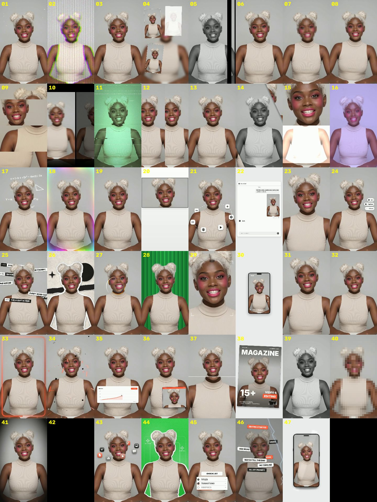

# Video Effects Pack

[English version](README.md)

47 готовых видеоэффектов для коротких вертикальных роликов (TikTok, Reels, Shorts), оформленных как **Agent Skill**: глитчи и тряска, зумы, интро и переходы, обложка журнала, карточка ИИ-чата, макеты телефона, светящиеся рамки, графики, чек-листы, шторм заголовков, иконки по орбите и другое.

Пользоваться можно двумя способами:

- **Через ИИ-ассистента, без терминала.** Один раз установите навык, прикрепите видео в чат и скажите, что нужно («добавь эффект обложки журнала на 1-й секунде, заголовок DAILY»). Ассистент всё запустит сам и вернёт готовый файл.
- **Через командную строку**, если так удобнее.

Всё считается локально на Python и ffmpeg. Никаких облачных сервисов и API-ключей.



*Кадры всех 47 эффектов, номера как в `--list` (пример: ролик с ИИ-сгенерированным человеком).*

## Где работает

| Платформа | Как установить навык |
|---|---|
| Claude (claude.ai, Claude Desktop) | загрузить `video-effects-pack.zip` в настройках |
| Claude Code | скопировать папку в `.claude/skills/` |
| OpenAI Codex (приложение, CLI, IDE) | скопировать папку в `.agents/skills/` или установить по GitHub-ссылке через `$skill-installer` |
| Google Antigravity | скопировать папку в `.agents/skills/` рабочего пространства |

Навык — это одна папка `skills/video-effects-pack/` в открытом формате Agent Skills (файл `SKILL.md` с инструкциями плюс скрипты и ресурсы), поэтому одна и та же папка работает везде. Инструкции для ассистента написаны на английском, а отвечает он на вашем языке.

> **Честная оговорка.** Скрипты и все 47 эффектов проверены на Linux с Python 3.13, ffmpeg и OpenCV 5.0 (плюс выборочная проверка на OpenCV 4.14). Шаги установки для каждой платформы взяты из публичной документации этих продуктов на момент написания; расположение папок и пункты меню могут меняться, поэтому если что-то не находится, сверьтесь с актуальной документацией.

## Требования

- Python 3.9 или новее
- `numpy`, `opencv-python` (или `opencv-python-headless`), `pillow`
- `ffmpeg` и `ffprobe` в PATH
- Вертикальное видео 9:16 (лучше 1080x1920). Другие размеры запускаются, но не проверялись.

Если ассистент работает **на вашем компьютере** (Claude Code, Codex, Antigravity, Claude Desktop с локальными инструментами), всё это должно быть установлено именно там. В **claude.ai** навык работает в песочнице Anthropic, где набор пакетов и доступ в сеть зависят от тарифа и настроек. Если в песочнице нет ffmpeg и нельзя поставить пакеты, ассистент скажет об этом; тогда запускайте через командную строку на своём компьютере.

**Перед началом (ставьте только то, чего нет):** если `python --version` (или `python3 --version`) показывает 3.9 или новее и работает `ffmpeg -version`, самое сложное у вас уже есть; Python-пакеты ассистент поставит сам. Если чего-то не хватает:

```
# Windows (PowerShell)   winget install Python.Python.3.12
#                        winget install Gyan.FFmpeg      (затем откройте новый терминал)
# macOS (Homebrew)       brew install python ffmpeg
# Linux (Debian/Ubuntu)  sudo apt install python3 python3-pip ffmpeg
```

Быстрая установка Python-пакетов:

```
pip install -r requirements.txt
```

Проверка, что всё на месте:

```
python skills/video-effects-pack/scripts/check_env.py
```

Скрипт печатает `OK` / `MISSING` по каждому пункту и заканчивает строкой `READY` или `NOT READY`.

## Установка навыка (терминал не нужен)

### Claude (claude.ai и Claude Desktop)

1. Скачайте `video-effects-pack.zip` со страницы Releases этого репозитория (или соберите сами: `python tools/make_zip.py`, файл появится в `dist/`).
2. Откройте **Settings → Capabilities → Skills** и загрузите ZIP. Нужен тариф, в который входят навыки, и включённое **выполнение кода** (code execution).
3. В чате прикрепите видео и напишите, например: *«Добавь глитч на это видео со 2-й по 5-ю секунду».*

### Claude Code

Положите папку в проект или в домашнюю директорию:

```
<проект>/.claude/skills/video-effects-pack/     (только этот проект)
~/.claude/skills/video-effects-pack/            (все проекты)
```

### OpenAI Codex

Либо скопируйте папку в одно из мест:

```
<проект>/.agents/skills/video-effects-pack/     (только этот репозиторий)
$HOME/.agents/skills/video-effects-pack/        (все проекты)
```

либо в самом Codex попросите запустить `$skill-installer` и дайте GitHub-ссылку на папку:
`https://github.com/neurolena1/video-effects-pack/tree/main/skills/video-effects-pack`.
Если навык не появился, перезапустите Codex. Вызвать его можно записью `$video-effects-pack` или просто описав задачу.

### Google Antigravity

Скопируйте папку в рабочее пространство:

```
<workspace>/.agents/skills/video-effects-pack/   (это рабочее пространство)
~/.gemini/config/skills/video-effects-pack/      (глобально)
```

Старые версии Antigravity использовали `.agent/skills/` и `~/.gemini/antigravity/skills/`. После копирования начните новую сессию, затем попросите эффект в чате или введите `/video-effects-pack`.

## Работа через чат

Прикрепите ролик и скажите, что хотите, на любом языке:

- «Сделай видео глитчевым со 2-й по 5-ю секунду».
- «Преврати ролик в обложку журнала с названием DAILY».
- «Покажи, какие у тебя есть эффекты».
- «Как в прошлый раз, но чуть медленнее и с текстом "NEW SEASON"».

Ассистент проверит окружение, сделает быстрый предпросмотр, отрендерит ролик целиком, сохранит рядом с исходником (оригинал никогда не меняется) и отдаст вам.

## Просто промпт (без установки навыка)

Любой агент для кода, который умеет запускать команды на вашем компьютере (Codex, Claude Code, Antigravity и подобные), может использовать пакет прямо из репозитория, не устанавливая его как навык. Положите видео в папку проекта, откройте агента в этой папке и вставьте промпт. Замените имя файла и эффект на свои.

**Один эффект:**

> Скачай https://github.com/neurolena1/video-effects-pack в подпапку. Прочитай `skills/video-effects-pack/SKILL.md` и следуй ему. Проверь окружение; если чего-то не хватает, скажи, чего именно, предложи, как поставить, и жди моего согласия. Потом возьми `my-video.mp4`, наложи эффект «vglitch» со 2-й по 5-ю секунду, сначала покажи короткий предпросмотр, потом отрендери полное видео и сохрани рядом с оригиналом.

**Эффект со своими текстами:**

> Используй `video-effects-pack/skills/video-effects-pack/SKILL.md`. Преврати `my-video.mp4` в обложку журнала (эффект 38) с 1-й секунды: название «ДНЕВНИК», строки «НОВЫЙ СЕЗОН» и «УЖЕ ЗДЕСЬ», большое число «10», подпись «СОВЕТОВ». Сначала предпросмотр, потом полный рендер, результат сохрани рядом с оригиналом. Добавь `--lang ru`.

**Несколько эффектов в одном видео:**

> Используй `video-effects-pack/skills/video-effects-pack/SKILL.md`. В `my-video.mp4`: резкий зум на 0,5 с, глитч со 2-й по 4-ю секунду и светящаяся рамка на 4-й секунде. Наложи всё за один рендер, сначала предпросмотр, потом полный ролик, сохрани рядом с оригиналом. (Или готовый образ: `--preset hook`.)

**Пусть агент подберёт сам:**

> Используй `video-effects-pack/skills/video-effects-pack/SKILL.md`. Посмотри `references/effects.md` и предложи 3 эффекта, которые подойдут для быстрого энергичного вступления в `my-video.mp4`. Когда я выберу, сделай предпросмотр и отрендери.

Примечания: агент может спросить разрешение скачать репозиторий, поставить Python-пакеты или запустить ffmpeg; одобряйте то, с чем согласны. Python и ffmpeg должны быть на вашем компьютере (см. «Перед началом»).

## Работа через командную строку

```
python skills/video-effects-pack/scripts/fx.py INPUT.mp4 OUTPUT.mp4 -e EFFECT [опции]
```

```
# список эффектов (номер, id, длина по умолчанию, что делает)
python skills/video-effects-pack/scripts/fx.py --list --lang ru

# глитч со 2-й по 5-ю секунду
python skills/video-effects-pack/scripts/fx.py in.mp4 out.mp4 -e vglitch --start 2 --end 5

# интро-эффект на 1-й секунде, растянутый до 3 секунд
python skills/video-effects-pack/scripts/fx.py in.mp4 out.mp4 -e quickzoom --start 1 --duration 3

# обложка журнала со своими текстами
python skills/video-effects-pack/scripts/fx.py in.mp4 out.mp4 -e magazine --start 1 --duration 3 --lang ru \
  --text "ДНЕВНИК" --items "НОВЫЙ СЕЗОН|УЖЕ ЗДЕСЬ|10|СОВЕТОВ|Внутри: рабочий процесс|Гид по технике|ВЫПУСК 5|МАРТ 2026"

# быстрый 3-секундный предпросмотр
python skills/video-effects-pack/scripts/fx.py in.mp4 preview.mp4 -e 38 --preview 3
```

| Опция | Что делает |
|---|---|
| `-e, --effect` | номер, id, русское название или `all` |
| `--start`, `--end` | когда эффект начинается; когда заканчивается непрерывный эффект |
| `--duration` | длина интро-эффекта (диапазон показывает `--list`) |
| `--preview N` | отрендерить только первые N секунд |
| `--repeat P` | демо: интро-эффект повторяется с паузой P секунд |
| `--text`, `--items`, `--opt ключ=значение` | тексты сценных эффектов (см. `skills/video-effects-pack/SKILL.md`) |
| `--style` | цвета сценных эффектов: `minimal` (по умолчанию), файл из `scripts/styles/` или ваш `.json` |
| `--lang en\|ru` | язык стандартных текстов некоторых сценных эффектов |
| `--face x,y,w,h` | только для мозаики: рамка лица в долях кадра |
| `--plan FILE.json`, `--preset NAME` | несколько эффектов за один рендер (см. ниже); `--list-presets` показывает образы |
| `--seed`, `--crf` | другой случайный узор; качество x264 (меньше — лучше, по умолчанию 17) |

Интро-эффекты проигрываются один раз с фиксированной длиной; непрерывные идут от `--start` до `--end`. Полная таблица эффектов, их длин и допустимых диапазонов `--duration` лежит в [`skills/video-effects-pack/references/effects.md`](skills/video-effects-pack/references/effects.md) (на английском; русские названия эффектов указаны в колонке «Russian name»).

## Несколько эффектов за один рендер и образы

Эффекты можно накладывать друг на друга за один проход (видео кодируется один раз). Готовые образы:

```
python skills/video-effects-pack/scripts/fx.py --list-presets
python skills/video-effects-pack/scripts/fx.py in.mp4 out.mp4 --preset hook
python skills/video-effects-pack/scripts/fx.py in.mp4 out.mp4 --preset cover-story --lang ru --text "ДНЕВНИК" --items "НОВЫЙ СЕЗОН|УЖЕ ЗДЕСЬ|10|СОВЕТОВ"
```

Образы: `hook` (резкий наезд с коротким глитчем), `glow-up` (блёстки и светящаяся рамка), `cover-story` (чёрно-белая вспышка, затем обложка журнала), `ai-chat` (ролик «приземляется» в ИИ-чат, затем всплывает чек-лист), `party` (цветовые качели, пульс и блёстки). Тайминги у них заданы от начала ролика и подходят для видео от 5 с.

Или составьте свой план в JSON-файле и передайте `--plan plan.json`:

```json
{"effects": [
  {"effect": "quickzoom", "start": 0.5, "duration": 1.5},
  {"effect": "vglitch", "start": 2, "end": 4},
  {"effect": "magazine", "start": 4, "duration": 2.2, "lang": "ru", "text": "ДНЕВНИК",
   "items": ["НОВЫЙ СЕЗОН", "УЖЕ ЗДЕСЬ", "10", "СОВЕТОВ"], "opt": {"barcode": "off"}}
]}
```

Эффекты применяются в порядке списка, каждый к результату предыдущего: сначала зумы, тряска и цветовые эффекты, потом наложения. Подробности и правила: [`skills/video-effects-pack/SKILL.md`](skills/video-effects-pack/SKILL.md) (на английском). Файлы образов лежат в `skills/video-effects-pack/scripts/presets/`; скопируйте любой, чтобы сделать свой.

## Свои цвета

Сценные эффекты по умолчанию используют нейтральную минималистичную палитру. Скопируйте `skills/video-effects-pack/scripts/styles/example-brand.json`, поменяйте HEX-цвета и передайте `--style ваш-файл`.

## Как экономить токены

Рендер идёт локально на Python и ffmpeg и токенов не тратит. Токены уходят только на то, что ассистент читает и пишет. По размеру файлов это примерно (оценка, не замер): загрузка `SKILL.md` при использовании навыка стоит несколько тысяч токенов, и примерно столько же `references/effects.md`, если ассистенту приходится подбирать эффект. Чтобы тратить меньше:

- Называйте в запросе эффекты, время и тексты. Тогда ассистент не читает список эффектов и не предлагает варианты.
- Для нескольких эффектов используйте образ или файл плана, а не описывайте каждый шаг.
- Пропускайте предпросмотр, когда уверены в тайминге, и пишите «кадры не разглядывай»: просмотр картинок самый дорогой шаг.
- Используйте один и тот же промпт для следующего ролика, а не объясняйте заново.

## Ограничения

- Рассчитано на вертикальные ролики 9:16; другие форматы не проверялись.
- Эффекты, отделяющие человека от фона, используют небольшую встроенную модель. Края волос могут получаться грубыми, а на роликах без видимого человека результат слабее.
- Встроенный шрифт (Inter) покрывает только латиницу, кириллицу и греческий. Для других алфавитов текстовые сценные эффекты покажут пустые квадраты.
- Рендер идёт только на процессоре: ролик 1080x1920 длиной 6 с считается несколько минут. Сначала используйте `--preview`.
- Звук исходного видео сохраняется; эффекты звук не добавляют.

## Отказ от связей

Это независимый проект. Он воспроизводит внешний вид распространённых пресетов эффектов видеоредакторов и написан с нуля. Он не связан с какими-либо разработчиками видеоредакторов, не спонсируется и не одобрен ими и не содержит их кода, ресурсов или логотипов.

## Лицензия и авторство

Код, документация и дизайн эффектов: [MIT](LICENSE), © 2026 NeuroLena.
Встроенные сторонние компоненты (шрифт Inter, модели U²-Net-P и YuNet, каскад Хаара из OpenCV) сохраняют собственные лицензии: см. [THIRD_PARTY_NOTICES.md](THIRD_PARTY_NOTICES.md).
